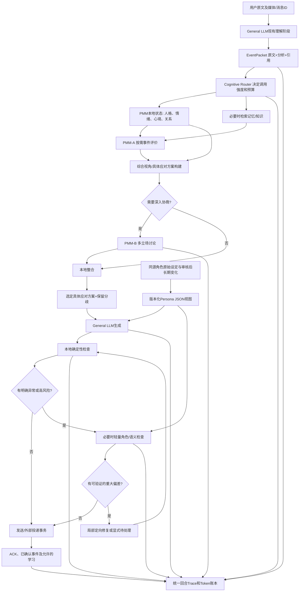

# 槐安梦客 2.8.2 · GPT-6.1 Sol Ultra 执行优化版（完整开发规范）

**文档版本**：2.8.2-SOL-1，2026-11-04  
**任务对象**：从实际 2.8.1 完整源码开发 2.8.2，而不是生成新的示意程序  
**开发模型**：GPT-6.1 Sol · Ultra（执行安排针对长代码库、分阶段工具操作优化；不是降低功能要求）  
**规范范围**：① B内部综合立场协商；② 未回复故障与校验器／原有人设联动；③ Event Packet、按需认知调用、Token优化和可视化  
**权威关系**：本文件**独立完整可读**，包含执行协议与原始2.8.2技术规范全文。前半部分规定**如何执行、分阶段交付**；后半部分规定**必须实现哪些功能**。如果涉及同一执行顺序，以前半部分的阶段门为准；具体数据语义、功能边界、验收标准以后半部分为准。不得以“适配Sol”为由删减原规格。

---

## A. 可以直接复制到开发对话的启动指令

> 现在执行我上传的《槐安梦客 2.8.2 · GPT-6.1 Sol Ultra 执行优化版》。以真实2.8.1源码为基底，**直接修改代码，不要先给我另一份开发建议书**。先执行本文件的 **阶段0**（核对项目、备份、复现失败、列出关键调用链），接着推进 **阶段1** 的未回复紧急修复；通过阶段门就继续后续阶段，不需要为每一小步反复问我。每阶段必须实际提交修改文件、运行能运行的测试、记录真实结果，并写入可跨轮继续的`docs/V282_PROGRESS.md`。不能因为时间、上下文或工具限制完成整版时，交付**当前已经完成的可运行结果**、失败或阻碍证据及下一阶段明确的继续指令；不能假报完成，也不能仅给出待办计划。
>
> **不可偏离**：PMM独立于General LLM；General给PMM的是用户原文＋结构化事件分析＋引用，不只是一段摘要；B是**同一完整人格**对一个事件形成多个具体且可竞争的情境应对方案，不是固定四个角色争论六个标签；校验器不得因`reply/clarify`或模型无效字符span吞掉正常回复；人设JSON从**现有创建／编辑角色的人设**同源编译；Token按调用、阶段、模型、上下文分项测量；保留2.8.1情绪、人格、记忆、关系、训练权重与已确认历史；兼容模式仅用于故障回滚。

## B. Sol Ultra 开发执行策略（解决长项目的上下文与执行风险）

### B1. 源码读取与工作方式

1. 在有文件系统与测试命令的开发环境中工作。优先处理**真实项目目录或已解包仓库**。若只拿到`HuaiAn_Dreamer_Source.md`合并源码，先按`BEGIN FILE/END FILE`边界提取到工作树，逐个核对源路径和文件hash；严禁在聊天上下文里一口气展开4MB源码后凭记忆修改。若该标记不存在，检查实际索引及文件内容，不得假定提取成功。
2. 初读只需项目`README`、`RELEASE`、`docs/V281_SPEC.md`、`docs/V281_ACCEPTANCE.md`、`docs/V281_LIMITS.md`，以及本文件规定的目标文件。每个阶段再读对应实现与邻接调用，**先找调用方/被调用方与存储协议，再编辑**。
3. 优先使用源码搜索与小范围文件读取，记录**文件、函数、入参、出参、失败处理、持久化位置、测试覆盖**。不得把“代码里有一个类”当作“实际回合调用了这个类”。
4. 保留原有目录结构、现有双内部LLM连接以及用户启动脚本；在原Engine/SQLite/outbox/UI上做真实改动。新增模块只负责清晰边界，不得偷偷另建平行2.8.2主系统。
5. 本规范提到的`persona/*`、`web/*`、`tests/*`路径来自已审查的2.8.1源码；若当前工作树不同，先定位等价模块并记入映射表，**不要盲目创建同名文件**。
6. 不必为了每阶段重复执行全部旧测试；**先目标单测、再相关集成、最终完整回归**。测试名称与实际pass数应以当前工作树为准，不能引用旧报告当作本轮结果。

### B2. 修改尺度：纵向完成一条路径，不做“全文件大翻修”

- 一次修改应形成一个可验收的**垂直切片**（模型契约→实际调用→持久记录→关键测试），而不是先一口气重写所有模型类、最后才把它接入Engine。
- 对共享枢纽`persona/engine.py`、`persona/execution.py`、`persona/server.py`和`web/app.js`采用**顺序、最小范围集成**。如果使用子任务/并行机制，只可并行检查互不重叠的文件；共享文件必须统一集成，避免互相覆盖。
- 每阶段修改前保存备份或Git提交（若仓库支持Git）；阶段完成后形成可恢复检查点。备份须包括数据与版本，不能只保存Python文件。
- UI必须读取后端真实落库数据，不能用静态样例冒充运行时观测。失败回合的认知中间结果和Token同样要可读。
- 模型连接不可用时可用**明确标为Mock/Fixture**的响应做工程测试，但真实Qwen、真实云API、真实Windows和QQ交付必须单独列出是否确实执行；不凭空声称成功。

### B3. 每个阶段的固定交付模板

每阶段在`docs/V282_PROGRESS.md`追加以下内容（不要覆盖旧阶段记录）：

```text
Stage: 0/1/2/3/4/5/6
Status: complete | partial | blocked
Source baseline: git hash或源文件清单hash
Changed files: 路径 + 一句话真实修改点
Runtime path: 用户输入→何函数→何结果→何存储/接口
Tests run: 原样命令、用例数、通过/失败/跳过、日志路径
Evidence: 真实trace/fixture/截图/计数或不可用原因
Compatibility: 旧人格、人设、记忆、情绪、发送与回退是否通过
Remaining: 尚未实现的具体事项（不粉饰）
Next exact action: 可直接继续执行的下一条操作
```

优先提交可运行源码、测试、日志，再写阶段摘要。**不得仅以“已设计好”结项**。若有工作资源限制，停止在可恢复检查点，并交付可复用的阶段继续指令；下一次从最新源码和进度文件复核后开始，勿重新开发已通过的阶段。

## C. 按依赖顺序执行的七个阶段与验收门

### 阶段0｜冻结2.8.1基线、建立可复现证据（不改认知逻辑）

**查看**：`persona/engine.py`、`persona/validation.py`、`persona/provider.py`、`persona/execution.py`、`persona/deliberation.py`、`persona/pmm_negotiator.py`、`persona/psychology.py`、`persona/subjects.py`、`web/app.js`、相关测试。

**完成**：
- 检查工作树完整可启动；列出当前General、A、B、NumPy、情绪、发送、记忆路径和出入口；确认已知失败`ab580f19d0794917a975823a8d82f391`怎样在当前代码里发生。
- 固定脱敏失败fixture：`clarify`/`reply`分歧、`invalid_evidence_span`及5次实际调用的usage。确认原始消息、生成候选、发送与ACK的状态边界。
- 对既有角色、原始`seed`、数据库、训练权重、关系、情绪状态建立备份清单和回滚点，禁止将新fixture混入真实学习证据。
- 运行当前条件下可用的少量基线测试；将未能执行的测试原因如实记录。

**阶段门 G0**：能够复现至少一个“生成成功、校验失败、未发送”的等价用例，并确认数据备份与工作树来源。只有读取历史日志、没有可执行fixture，不算完整通过。

### 阶段1｜P0：先解决无回复和无效证据校验

**优先修改**：`persona/validation.py`、`persona/engine.py`的候选生成/检查分支；必要时触及`persona/execution.py`以保留已完成阶段及正确发送状态。

**实现**：
- 去掉`detected_action == expected_action`这种标签等值作为一票否决依据；保留旧行动枚举的持久化/发送兼容，正常流程按具体交流目标和明确事实/权限检查。
- `spans`由LLM输出逐字quote与证据ref，**字符索引由本地代码定位**；找不到唯一证据必须返回“无效/歧义证据”，**不是给候选定罪**。
- 本地硬检查每轮执行；一般轻微风格偏差仅记日志；明显且证据有效的任务偏离才定向修复；真正不实工具结果、权限或已启用硬边界不得放行。
- 检查器故障与候选违规分开：低风险在硬检查通过时可继续发送；不能确认硬约束的保留明确待处理状态；无声失败改成可见故障；投递`DELIVERY_UNKNOWN`不能盲目重试。
- 阶段1可直接使用**原有profile已有字段的轻量只读视图**进行必要校验；最终版本化PersonaViewCompiler在阶段4完成。不得为等阶段4而推迟本阶段的未回复修复。

**阶段门 G1**：旧故障回放不再因无效span/互斥标签吞掉正常候选；明确严重违规仍受拦截；未发送候选不写成已回复/新记忆；有可执行复现日志。**G1不通过，不得以B/UI工作掩盖。**

### 阶段2｜P0：先测量，再实现选择性调用

**优先修改**：`persona/engine.py`理解与检索入口、`persona/provider.py`和`persona/pmm_connections.py`所用的真实适配器、`persona/execution.py`记录结构。新建EventPacket/Router/TokenLedger模块须接入真实调用链。

**实现**：
- 升级已有`UNDERSTAND_V3`一次调用，输出可追溯`EventPacket`，同时传递**当前用户原文、分析、多事件/媒体/历史引用**；不能只送摘要，也不能新增重复前端理解调用。
- `CognitiveRouter`依事件、关系、记忆/知识需求、歧义、不确定性与权限因素规划L1/L2/L3、相关性检索、A/B是否深化和预算；允许证据发现后升级，不能只按消息长度判复杂度。
- 保持本地人格/情绪数值运算；决定的是向LLM递送什么、是否需要深入调用。阶段2先可运行旧B协议，但其调用记录必须保留，待阶段3升级B内部方案。
- **TokenLedger先贯穿所有Provider调用**（General、A、B、校验/修复）、重试与失败；请求前按section记录估计Token，请求后按服务端usage记真实总量与缓存命中，缺失标unknown而非0。
- 以5调用fixture核对：输入133824、输出1791、总135615、缓存命中32000、调用5次。数值来自旧失败样本，不等于新版本应达到的效率。

**阶段门 G2**：简单闲聊不被无条件扩展为全量记忆/人格上下文；重要历史或复杂情境仍能检索和升级；五调用账本精确对账；每一次实际API调用的角色和触发原因可查。

### 阶段3｜B：同一完整人格的综合立场与具体方案协商

**优先修改**：`persona/deliberation.py`、`persona/pmm_negotiator.py`、`persona/policy.py`、`persona/engine.py`的B/最终方案接线，必要时扩展`persona/execution.py`。

**实现**：
- 每个综合视角都基于**同一个完整主体状态**，有不同事件解释、关系推断、具体任务内容、应对策略与预期后果。不得把价值/情绪/关系拆成互不相关的“人格人”。
- 1..K立场由具体情境决定，可只有1个；B内部模型按需补强，不做固定人设对骂或机械四人会议。非共识的可行方案按加权效用汇总成“相对支持度”，原始效用可追溯；56%不自动叫心理概率。
- 不再只在六动作标签上投票；方案必须覆盖**任务内容**，例如《出师表》请求要涉及是否能背、如何答、是否需核验，而不能只决定“回避/温和表达”。
- 取消分差小就强制`clarify`；只有真正必要信息缺失或不可执行时才考虑询问；硬边界优先于支持度。
- 讨论数据按回合落库，失败回合也可检索；不把未选中候选及未发送话语当作已发生经历。

**阶段门 G3**：相同用户输入在不同关系或人格/情绪条件下呈现可解释的不同方案；未选中立场可重读；B未调用/出错时不谎称深入协商成功；原始任务可完成。

### 阶段4｜同源人设JSON与最小必要Prompt编译

**优先修改**：`persona/psychology.py`、`persona/subjects.py`、`persona/engine.py`回复生成分支、`persona/provider.py`所需提示编排入口。

**实现**：
- 从现有人设`pmm_profile.name/seed/character...`以及**已审核**长期变化生成版本化JSON；原角色编辑更新立即使缓存失效；General生成视图与异常检查视图始终同revision；不得创建另一个会自我变化的“新角色资料源”。
- `PromptCompiler`按任务提取当前原文、确有必要的历史/记忆、当前部分人格情绪与B最终方案；**不再把整个`conditions`打包发到回复生成**。
- 跨字段重复按source_ref与语义digest安全去重；保留必要语境和引用；所有压缩不删除数据库原文和可恢复证据。
- 根据阶段2账本实测的字段膨胀源做优先级压缩，不凭猜测硬截断，不把本地缓存错误称为API输入Token减少。

**阶段门 G4**：人设创建/编辑→下一轮生成/审查立即同版；生成不发送全量心理对象；对相同样本展示优化前后实际Token与任务完成度；复杂任务检索质量未退化。

### 阶段5｜一个PMM运行工作台：真实历史、B支持度和Token图

**优先修改**：`persona/server.py`运行/历史接口、`web/app.js`、`web/index.html`及现有UI测试。

**实现**：
- 展示每轮输入分析、路由L1/L2/L3、实际记忆检索、本地心理运算、A与B具体调用、候选方案与支持度、生成与校验状态、发送回执。
- 支持每轮历史查阅B综合立场（来源/不确定性/权重/未选中的方案）和Token分项（真实usage＋明确标注的字段估算、缓存与重试），故障回合也不丢。
- 显示**是什么、做什么、何时调用、实际是否调用、用了多少**，不写冗长空泛的防御性文案；仅在选择备用兼容模式时才展示旧选项。
- 未来动画只预留数据结构，**这次必须先让真实数据可视化**，不增加假动画/占位状态替代实现。

**阶段门 G5**：真实UI操作能打开任意成功及失败回合，查看B立场、来源/支持度、每次调用与Token；单次usage为真实或清晰标识估算；导出和权限隔离正确。

### 阶段6｜全局回归、真实集成、可回滚交付

**建议命令（按项目实际依赖与平台验证）**：

```bash
python tests/run_v281_regression.py inherited
python tests/run_v281_regression.py v28
python tests/run_v281_regression.py v281
python tests/run_ui_v281.py
python tests/browser_v281.py
python tests/upgrade_v281.py
python tests/capture_v281_transport.py
```

此外执行2.8.2新增专项测试、发送故障注入、多角色与多人会话隔离、旧数据迁移、同事件输入的Token差值和心理表现回归。原2.8.1交付报告的**709 Python／116 HTTP-DOM／15浏览器**是历史基线，不是此轮可自动声称的数量；逐组报告真实运行数和命令。

- 本地Ollama、云API、Windows原生环境、真实QQ的覆盖范围必须按实际执行说明，Mock和可控HTTP测试不能替代真实外部服务测试。
- 所有新的数据库字段/版本有迁移与回滚路径；旧人设、栗子角色、已学习模型与原始消息必须能保留。
- 报告功能质量、错误率、Token和延迟的优化前后对照；缺少实测数据就写未测，不能先写节省百分比。

**阶段门 G6**：可运行2.8.2真实源码、关键故障得到复现和验证、所有可执行回归无新致命退化，界面与日志可核查，并交付迁移/回滚说明。若部分真实外部环境暂不可用，则如实列为外部验收未完成，不能声称全平台已验证。

## D. 关键跨阶段依赖及冲突处理

- **先回复可靠性，再压缩/重构**：阶段1不能等完整PersonaJSON；阶段4也不能重新引入“每轮必调LLM校验”。
- **阶段2先账本，阶段4才有严格节省证据**：不能在没有section测量时宣称哪块Prompt占比多少；旧日志只知道每个API请求的总Token。
- **阶段3 B综合方案，阶段4 General据此生成**：新方案输出字段须有兼容适配，不能破坏既有旧存储或导致新旧流程同时重复发送。
- **人格/情绪计算不断线**：L1轻量意味着减少额外LLM及无关记忆，不等于停掉人格、情绪及时间动力学。新的情绪模块已经是2.8.1事实基线。
- **角色资料单源**：阶段1用只读原profile检查、阶段4编译版本化PersonaView；不得积累两个互相覆盖的角色文件。创建人格时填写的人设不能丢失。
- **不靠“最大回复率”绕开真正限制**：风格偏差只是提示；真实权限、事实、服务安全与发送幂等不能被角色投票或错误处理绕开。候选未发送必须是`FAILED/HOLD`等可见状态，不是`NO_ACTION`。
- **资源不足时优先顺序**：G1无回复修复 ＞ G2真实Token账本与路由 ＞ G3 B综合视角 ＞ G4同源人设与Prompt缩编 ＞ G5可视化 ＞ G6回归。注意G2后的仪表盘应先能查原始数字，再完善UI；不允许无限推迟可视化。

## E. 便于持续开发的“阶段继续”模板

当工作中断需要在下一条开发对话继续时，直接提供以下信息（从真实源码与进度记录填写，而不是套用本文件示例值）：

```text
继续执行《槐安梦客2.8.2-SOL-1》。本项目最近已完成的阶段门：G__。
工作树/提交：__；当前代码与数据备份位置：__。
已修改并验收的文件：__；实际通过的测试及命令：__。
目前阻碍或失败日志：__；下一优先阶段：__。
请先打开docs/V282_PROGRESS.md并检查当前工作树，而不是重新写一份计划；
继续修改真实源码、运行测试、更新阶段记录。
保持原有三项功能与所有人格/情绪/记忆/关系约束，不做替代简化。
```

---

# 第二编：2.8.2完整技术开发规范（原规范保留）

以下为2026-11-04的《三项核心架构修改——完整开发与验收规范》技术正文。**保留原功能规格与测试矩阵**；若后文提及“在本轮完成全部阶段”，在Sol Ultra执行版中理解为**在可用工程环境持续推进，直到阶段门完成或遇到真实阻碍；每个已完成阶段立即可交付、可复验**，不得将它解释为必须用一条聊天消息凭空宣称全部完成。

# 槐安梦客 2.8.2：三项核心架构修改——完整开发与验收规范

**版本**：2.8.2 统一开发规范（2026-11-04）  
**适用基线**：2026-11-04 交付的 2.8.1 源码；在现有完整PMM上修改，不另造平行原型。  
**修改范围**：① 同一主体的多综合视角内部讨论（PMM-B）；② 回复校验及与现有角色人设联动；③ Token优化、事件分流和运行可视化。  
**文档性质**：交给开发对话的**实施要求**，不代表任何修改已经完成。算法的心理学有效性仍须单独验证。  
**优先级**：P0——不回复故障修复、输入契约/路由和 Token 计量；P1——B的综合立场方案化、角色快照和完整UI；最终必须按整个系统验收。  

> **一句话总目标**：保留一个完整、持续学习的人格主体。通用语言模型将**原始对话＋结构化事件分析＋上下文引用**交给PMM；PMM按需选择记忆、人格、情绪、关系及内部模型的计算强度，在同一主体内形成可并存、可竞争的综合情境立场；General LLM依据最终应对方案和**现有角色资料生成的结构化人设视图**进行表达；校验系统只检查有证据的明显偏差，不能凭标签不一致吞掉正常回复；每次调用的原因、上下文内容体积、真实Token与最终决策均可追溯。

---

## 0. 不可偏离的架构边界

1. **PMM ≠ General LLM**。General LLM面向用户，负责理解输入、语言表达；PMM是独立的持续记忆、心理计算、事件评价、情绪、关系、内部协商与决策增强组件。PMM-A（事件/心理语义推理）、PMM-B（综合视角讨论）分别支持本地LLM和云API，也允许共用物理服务，**不能因此混成同一个逻辑角色**。
2. **多视角 ≠ 多个预设人格**。无论出现几种内部立场，都属于**同一个AI、同一份真实人格/价值/情绪/记忆/关系状态**的不同条件化情境解释；不得把HEXACO、Schwartz、情绪或关系直接当成四名互不相干的角色；也不得预设“积极/消极/理性/感性”几人固定开会。允许任何数量的立场（包括1个）、允许相互冲突、不强迫共识。
3. **当前消息原文不可被事件摘要替代**。General LLM传给PMM的必须包括**当前原文**、结构化分析、说话人与时间/会话标识、媒体和历史的引用。结构化分析用于路由，不是PMM的唯一事实来源。原文必须能够再读取以纠正错误初判。
4. **人设快照 ≠ 新人设数据源**。原有创建/编辑角色资料是唯一权威来源之一：`pmm_profile.name / seed / character.self_reference / character.initial_personality`及已经存在的表达风格、边界和经审查的长期学习结果。JSON是**这份资料的版本化编译视图**，不能另起一个会自行演化、与原设定不一致的人设体系。
5. **本轮PMM数值计算与LLM调用是两回事**。人格/情绪数值前向可每轮执行；决定是否需要A/B的昂贵LLM、检索多少记忆、发多少上下文，必须由路由与预算控制。省Token不等于删除心理构念或停止更新情绪。
6. **禁止假沉默、假行动、假经历**。`NO_ACTION/WAIT/REFUSE`来自实际决策；`CHECKER_ERROR/VALIDATION_FAILED/DELIVERY_UNKNOWN`是故障，不能伪装成主动不回复。未发送内容不能被记为已发送、不能回流成已发生经历、不能触发长期人格提交。外部发送保留原有outbox/ACK/幂等保护。
7. **备用兼容只作故障恢复**。2.7路径隐藏在单一「PMM应用方式」选择器的备用模式里，不做日常对照，不在新页面复活一堆旧配置。确定新版稳定后另立删除任务；本版本不得提前删旧数据/权重。
8. **保留2.8.1情绪公式及状态分层**。新E系列情绪动力学、快慢心境、调节策略和当前人格计算是B讨论和路由的输入基础；此版本原则上不改核心心理数学公式，除非为修接口修复必要bug，并须单独记录。
9. **不可为“防止出错”擅自改变拟定认知能力**。硬约束只限真实事实、权限、用户定义的明确边界及平台/软件必要安全限制；对表达习惯、人格倾向、讨论分歧实行软约束，不得把人格变成永远固定说法。

## 1. 已知源码及故障基线（开发前必须复核）

本规范已根据已提供的2.8.1源码定位；如果后续仓库更新，请开发者逐项查找同等调用链，**以实际当前文件和版本为准，提交最终定位表**。

| 实际位置 | 2.8.1行为 | 需要改动 |
|---|---|---|
| `persona/engine.py` `UNDERSTAND_V3`、第1阶段理解 | 已抽取 `intent/semantic/knowledge_need/keywords`，但首轮就发送大量人格先验/关系资料，且缺少标准输入包和下游路由协议 | `EventPacket` + `CognitiveRouter`；轻量入口、保留原文与引用 |
| `persona/engine.py` `self.retrieve(...)`（约397行） | 理解结束后直接检索 | 改成按事件需求/证据缺口触发并可二次扩检 |
| `persona/deliberation.py` `views/ASSESS/REVIEW` | 基于单个注册构念挑选视角，评估六动作效用 | 基于**完整共同心理状态**生成综合解释/应对方案 |
| `persona/pmm_negotiator.py` `Negotiator.assess` | B独立连接已实现，仍主要评价六种动作 | 新讨论契约、方案效用、分歧和依据、B按需增强 |
| `persona/policy.py` `choose` | 对六动作打分，输出单标签 | 方案级选择与约束；六动作仅为兼容映射 |
| `persona/engine.py` 约602行 | 未解决分歧且两最高分差小于0.08时可能强制 `clarify` | 删除“仅因分差小自动澄清”；只按真正信息缺口/硬条件执行澄清 |
| `persona/engine.py` 约633–646行 | `REALIZE + dumps(conditions) + history + 原文`；`conditions`重复包含人格/情绪/记忆/中间结果 | `PromptCompiler`按任务最小必要字段组装 |
| `persona/validation.py` `candidate_check`、`ACTION_CHECK_PROMPT` | `detected_action == expected_action` 的强制一致性；模型提供字符索引span；报错重试 | 明显偏差/事实/权限审查，弱化一对一标签；本地证据定位，分级处置 |
| `persona/validation.py` `validated_call` | 校验失败重新提交完整请求+报错 | 区分checker自身故障与候选错误，局部修复；不无限复制上下文 |
| `persona/psychology.py` `empty_profile/profile_condition` | 有 `name/seed/character` 等原人设；`profile_condition`传完整心理资料 | 编译版本化、轻量、可追溯的同源角色JSON视图 |
| `persona/subjects.py` `edit_character` | 原角色编辑可修改 `name/seed/character`、修订号与备份 | 编辑→同源快照失效→重新编译→生成/检查共享版本 |
| `persona/server.py` `/api/persona/settings`、`/api/execution` | 已有角色修改和执行追踪接口 | 扩展回合B历史、Token账本、失败复盘与UI |
| `persona/execution.py` `ExecutionJournal` | SQLite留存回合、发送outbox、ACK | 在其基础上关联新认知/Token记录，**不得破坏事务** |
| `persona/pmm_connections.py` | A/B的独立/共用连接与测试已实现 | 保留；按role归因Token与调用原因，不重建配置UI |

**真实失败回合**：`turn_id=ab580f19d0794917a975823a8d82f391`；冻结行动`clarify`、校验器`reply`、`/spans/0 invalid_evidence_span`、一次校验重试仍失败、候选生成但`delivery_may_have_occurred=false`。该例必须成为测试固定样本，且不得将“候选生成失败”误报为原因。

**真实Token基线（这一次失败回合，模型供应商usage）**：

| 调用 | 输入 | 输出 | 缓存命中 |
|---|---:|---:|---:|
| General理解 | 15,010 | 208 | 384 |
| PMM内部分析 | 28,186 | 1,305 | 768 |
| General生成 | **64,047** | **17** | 17,536 |
| 首次候选检查 | 13,146 | 135 | 256 |
| 重试候选检查 | 13,435 | 126 | 13,056 |
| 合计 | **133,824** | **1,791** | **32,000** |

总Token **135,615**；未命中缓存输入 **101,824**。缓存命中属于输入子集，不能重复加总。现有日志缺失字段级真实Token，**不允许声称各字段有准确百分比**。以上数字用来验证账本，不能误认为每一轮都使用相同用量。

---

# 问题一：PMM-B「同一完整人格的多立场内部讨论」重构

## 2. 核心语义——讨论的是“完整应对方案”，不是表达标签

### 2.1 对象定义

- **共同主体状态**：本轮同一AI的稳定人格与不确定性、价值、当前情绪/慢心境、关系及事件记忆、边界、知识可用性、角色设定来源。必要时只有相关子集被物化给LLM，但不同立场的根身份、稳定状态不能互相矛盾。
- **Perspective / 综合立场**：同一主体对当前事件的一种**自洽但可竞争的情境解释、意图理解、关注点、候选回应内容、社交/任务策略及预期后果**。它是临时的认知假设，不是人格实体、已发生事实或另一名Agent。
- **ResponsePolicyProposal / 应对方案**：不仅有“回/不回/澄清”，还要包含**要回应的具体任务、核心内容、态度、目标、策略、知识/记忆依据、待核实部分、表达方式与可行性**；复杂场景允许多步方案，简单场景保持短小。
- **Support / 相对支持度**：多个立场对同一组**可比方案**的加权条件效用聚合，允许非一致结论。`56%`可为归一化相对支持，但**不得未经校准解释为客观心理概率**。

### 2.2 禁止设计

- 禁止预先设置“积极人格、消极人格、关系人格、价值人格”四个固定发言角色。
- 禁止让每个视角只持有一个HEXACO或Schwartz值而忽略完整角色背景。
- 禁止把B简化为评估六个`reply/unknown/clarify/disagree/decline/silence`标签、再进行多数投票。
- 禁止把“分歧尚在”“最高支持未过50%”或分数差小本身当作自动追问理由。
- 禁止为了表面丰富每轮强制形成3~4个近似同义视角，也禁止在用户未要求推理解释时把内部讨论全文输出给用户。
- 禁止默认把B的假设、候选回复、模拟情境写成真实经历、长期人格证据或关系事实。

## 3. B的建议运行方式

1. `EventPacket`在前端生成后，router读取**原始消息与结构化线索**，进行初步需求/复杂度判断。
2. PMM执行当前情绪时间转移、状态读取、相关记忆与关系检索；A模型按需提供细化事件评价；Learned人格组件参与当前反应条件计算。
3. `PerspectiveBuilder`使用**同一个完整主体上下文**产生1..K个候选综合立场（K由真实歧义、冲突与计算预算决定，建议初期上限4或5，配置可调；默认不固定数量）。
4. 本地数值计算始终可以生成最小的“本轮倾向/方案记录”；是否请求B的LLM深化，由条件触发：多解歧义、关系/价值冲突、需要复杂策略或高不确定性，以及明确用户配置。
5. B模型可补足立场的**情境解释、任务内容方案、条件、后果及证据**，但不能更改核心人格事实、未经验证的记忆、隐含权限；B的结果由合约校验并汇总。
6. `PolicyResolver`去重同义方案、筛除被硬约束禁止的方案，对**可执行的具体方案**计算综合支持度，返回胜出方案与仍未解决的分歧；若信息缺口真正阻碍任务才选择主动追问。
7. 保存所有被采用/未被采用的立场、来源、权重、方案及计算依据，供每轮历史查阅；失败回合也要保存已完成阶段的资料。
8. General LLM只接收**最终具体方案与必要的少量角色/情绪/事实条件**，不重新阅读整个内部讨论。

### 3.1 B输出契约（示例结构，不照抄示例内容）

```json
{
  "schema": "pmm-deliberation/2.8.2",
  "turn_id": "turn_123",
  "persona_id": "persona_123",
  "shared_state_ref": "state_123",
  "discussion_mode": "local_plus_B",
  "event_ref": "event_123",
  "perspectives": [
    {
      "id": "v1",
      "hypothesis": "对方可能在随意回忆课文",
      "confidence": 0.64,
      "salient_factors": [
        {"type": "relationship", "ref": "relation_3"},
        {"type": "style", "ref": "trait_snapshot_v7"}
      ],
      "evidence_refs": ["msg_001"],
      "goal": "接住熟人话题，同时确认任务需求",
      "proposal_ids": ["proposal_a"],
      "expected_consequences": ["保留自然交流节奏"],
      "limitations": ["用户真实目的仍不确定"]
    }
  ],
  "proposals": [
    {
      "id": "proposal_a",
      "task_handling": "先回应是否记得，再按需要背诵",
      "content_goal": "回答关于出师表的问题",
      "social_strategy": "熟人式自然接话",
      "knowledge_policy": "只引用可确认的知识，不虚构记忆",
      "expression_hints": ["口语化", "可适度调侃"],
      "information_gaps": [],
      "hard_constraint_status": "eligible"
    }
  ],
  "support": {
    "method": "weighted_utility_softmax_unverified",
    "proposal_a": 0.56,
    "proposal_b": 0.27,
    "proposal_c": 0.17
  },
  "selected_proposal_id": "proposal_a",
  "unresolved_disagreement": true,
  "selection_reason": "在可行方案中综合支持度最高"
}
```

`0.56/0.27/0.17`是说明计算字段的**示例值，不是当前程序的实测结果**。实际JSON必须使用统一Schema校验、来源ID检查、可行性检查，低复杂度允许`perspectives`只一项，简单情境允许仅输出一个proposal。

### 3.2 支持度数学定义（第一版可执行建议）

对同一轮可行方案集合 \(\mathcal A_t\)，每个综合立场 \(v_k\) 有上下文激活权重 \(w_k\)（\(w_k\ge0\), \(\sum_k w_k=1\)）及对方案 \(a\) 的有限效用 \(U_k(a)\)。

\[
S_t(a)=\sum_k w_k U_k(a)+B_{\mathrm{person}}(a)+B_{\mathrm{emotion}}(a)+B_{\mathrm{relationship}}(a)
\]

上述B项**只能表达没有已包含在\(U_k\)里的、可追溯的增量**；若立场效用已考虑该信息，不得双重计数。可行方案上显示：

\[
P_{\mathrm{support}}(a)=\frac{\exp(S_t(a)/\tau)}{\sum_{b\in\mathcal A_t}\exp(S_t(b)/\tau)}
\]

\(\tau>0\)是可校准温度参数。这里的值叫 **相对支持度**，不是实测人格概率、不是模型置信度，更不是伦理或权限投票。硬约束先筛除不可行方案。若最高分仅略领先，也可选择它并保留分歧；只有缺失必要事实/明确不可执行时才询问或承认不知道。支持度应能分解为视角贡献，保留原始分数与版本/校准状态。未来可以研究学习式融合替代手工权重，但本次必须做到可运行、可复现、可解释。

### 3.3 防止“B只说表达方式”

将方案字段强制区分以下语义组，但不要求所有情况都复杂填满：

- **Event interpretation**：用户为什么问、他可能指哪个事件、信息缺口是什么；可以有多种解释及证据强弱。
- **Task/content handling**：回答什么具体问题、要不要引用知识或记忆、是否要继续背诵/总结/追问、能否直接完成。
- **Interpersonal appraisal**：和对方是什么关系、当前信任或熟悉度可能怎样影响理解（不能把猜测当确认关系）。
- **Affect and motivation**：整个主体当前的情绪、动机、利益和价值冲突；不是“情绪人格”单独投票。
- **Strategy and consequences**：可能怎么处理、预计后果、潜在误解、替代策略。
- **Expression**：最后才决定自然用什么语气、长度和节奏表达。

**必须包含具体的任务完成度评估**。例如“请背出师表”不能在未考虑知识任务的情况下，只在“温和表达/直接答应/回避”之间打分。又如“熟人问‘你还记得《出师表》咋背的吗’”，可以自然答“记得点开头，你这是要抽查我？”或真正背诵，取决于任务理解、知识状态、关系、角色倾向与对话历史；不可强制统一模板。

### 3.4 B阶段每轮历史保存与可视化

最低保存：`turn_id/trace_id`、事件包版本、共享心理状态摘要引用（非全量敏感正文）、B是否调用/跳过及原因、每个视角的解释和证据ref/权重、每个方案的目标和核心内容、原始效用/相对支持、所选方案及未解决分歧、模型/提示词版本、token、耗时、失败状态、实际最终回复/发送状态引用。未发送内容不能写成已发言；失败时保留此前已完成阶段记录。

UI **必须在PMM运行历史中按回合查阅**：

- 「本轮内部立场」：1..K张立场卡，显示观点一句话、主要依据、可信/不确定信息、支持哪一方案。
- 「候选方案支持」：横向支持条及最终选中项，显示“相对支持度（未经校准）”；允许点击查看各视角对该方案的贡献。
- 「如何得出」：展开后显示原始证据ID、当前人格/情绪/关系作用、B是否真调用、有没有重新检索。
- 「失败时」：仍能浏览已完成的讨论记录，且明确是候选失败还是发送失败。
- 预留数据格式供未来动画/图像表现，但**当前优先真实数据可视化，不用动画冒充实际计算**。

---

# 问题二：校验器重构——显著偏差才修复，联动现有人设

## 4. 核心目标

1. **校验器不再拥有“因为两个行动标签不相等就否决整轮”的职能**。当前六动作可作为旧数据/发送行为兼容映射保留，不再作为正常语言表达的刚性语义判定。
2. 校验分为两层：**确定性硬约束检查（必要且本地）**；**异常触发的轻量角色/语义复核（可选）**。不需要每轮再调用LLM做一套大审查。
3. **“轻微风格偏差”默认仅记录，不重新生成**。明显且有证据的偏离才做定向修复；无法给出可信证据的审查意见只能标记为“未证实”，不能直接阻断候选。
4. 校验器正常作用是纠正明显错答、越权、虚构已执行任务、角色严重失真或违反角色的明确约束，而非惩罚自然语言表达不符合某个单标签。
5. 当校验器本身结构错误/模型超时时，必须能区分“候选违规”与“检查器不可用”。低风险且通过本地硬检查的文本可按配置继续发送并留下记录；涉及无法确认的硬约束则进入明确的故障/待修复状态，不能伪装成AI主动沉默。

## 5. 原有人设文件的单源联动（重要硬约束）

现有角色资料以 `pmm_profile` 为核心，至少有：

- `name`（角色名）
- `seed`（创建时输入的角色设定文本）
- `character.self_reference`（第一人称自称）
- `character.initial_personality`（创建/编辑角色的初始描述）
- 原有 `style`、`boundaries`、`beliefs`、`patterns` 等；以及有证据、经审查的长期人格/表达倾向。

**要求**：继续保留现有角色创建、编辑、导入、导出、回滚/检查点，不另外让用户重新填一张“校验器人设卡”。新增 `PersonaViewCompiler`（或同等模块），在读取**该同一个profile版本**后编译：

- `persona_card.json` 或数据库中的版本化JSON视图（必须有可靠的存储与更新路径，不能只在UI显示）。
- `generator_view`：用于General LLM语言生成，包含身份设定、稳定表达习惯、可核实背景、硬边界、当前本轮极简状态和方案目标。
- `checker_view`：由同一份底稿派生的更短角色一致性材料（仅异常时读取）。
- 视图是派生缓存：保留 `profile_id/source_revision/source_digest/compiled_at/compiler_version/learned_revision`，能因手动编辑或有证据的长期学习变化而失效重编译；不能反向作为独立的权威人格文件。
- **创建/编辑原人设后即时生效**：通过现有 `/api/persona/settings` 等路径自动触发失效/重编译，生成模型和检查器必须使用相同的`profile_revision`；不允许一新一旧。
- 人工明确设定与学习得到的“倾向/推测”区分来源：不能一次普通情绪波动就永久改写`seed`；不能把AI自己生成的聊天句子自动升级为已经真实经历；长期学习记录达到审查/证据门槛才能进入**派生的已审查习惯/角色变化视图**，如确需覆写原始角色设定必须有明确授权和版本化操作。
- **角色初始设定可为自然语言，JSON只是一种结构化编译结果**。已有实际人设内容不可凭空重写成新形象；未知字段保持未知。
- 支持导入旧版人格包的迁移，保留“栗子”等已有实例、对话、关系及训练数据。删除/切换角色时不能泄漏另一角色快照。

### 5.1 快照字段示例（结构示意，不是栗子的真实数据）

```json
{
  "schema": "persona-view/2.8.2",
  "profile_id": "persona_123",
  "source_profile_revision": 19,
  "source_digest": "sha256:...",
  "learned_revision": "learned_revision_7",
  "identity": {"name": "角色名", "self_reference": "我"},
  "author_settings": {"seed_excerpt": "原有人设内容的必要节选"},
  "behavioral_tendencies": [
    {"description": "与熟人更自然随意", "source": "owner_or_reviewed_learning", "certainty": "tendency"}
  ],
  "hard_boundaries": ["明确启用的边界ID"],
  "compiled_views": {
    "generator_view_ref": "view_general_19",
    "checker_view_ref": "view_checker_19"
  }
}
```

真实实现可以有额外结构，但需要**可还原到现有角色原始内容**、稳定版本、来源、冲突处理和回滚能力。原人设的全部文本仍保存在原角色系统，JSON中节选不是删改原设定。

## 6. 重新定义“校验”和“修复”

### 6.1 使用**偏差分类+严重程度**，不使用互斥行动标签

建议 `CandidateInspection` 包含以下字段：

- `decision_plan_ref`：PMM实际选择的**具体方案**，而不是单独`reply/clarify`。
- `local_checks`：结构、空文本、媒体能力、可确定的引用/权限、工具/发送回执、硬边界。
- `suspected_issues`：可见偏差；带`type/severity/evidence_ref/quote/confidence/verifiability`，禁止无证据硬拦截。
- `disposition`：`SEND` / `SEND_WITH_NOTE` / `REPAIR_CANDIDATE` / `HOLD_HARD_CONSTRAINT` / `CHECKER_UNAVAILABLE`，结果状态不得自动写成`NO_ACTION`。

严重程度（工程建议，可调整阈值并需实测）：

| 检查结果 | 处理 | 再调用LLM？ |
|---|---|---|
| 结构/字符偏移可确定修复 | 本地修复后继续 | 否 |
| 自然表达稍长、轻微偏离典型语气、存在额外但合理的问句 | 记录低严重度并发送 | 默认否 |
| 未能证明的“角色不一致”；语义判断证据缺失 | 标记`unverified`，不能当作违规 | 默认否 |
| 对具体任务出现重大遗漏或明显偏离所选方案 | 小上下文定向修复 | 视情况一次 |
| 确凿违反启用硬边界、无授权敏感披露、虚构真实工具结果/送达或高风险事实 | 阻止该候选，针对性修复/人工处理 | 受控调用 |
| 校验器自身JSON/证据偏移错误或服务失败 | `CHECKER_UNAVAILABLE`，按硬检查与风险决定继续/待处理 | 不得无限重试 |

**不得让软性角色一致性检查拥有无条件的最终否决权。** 人格是倾向，不是机械行为约束。例如平时不善表达关心的角色在重要事件中突然关心朋友，不等于角色失真。

### 6.2 硬约束需要客观来源

“硬约束”必须可追溯到明确启用的边界、事实来源/工具回执、真实权限、有效平台规则或结构协议；检查器不能把自己主观推测的“这个角色应该冷淡”升级为硬约束。对多模态不可读、实时信息未核验、明确虚假回执等仍须采取适当限制；不能为了避免无回复而直接放行不实事实或越权行动。

### 6.3 不再要求LLM计算字符偏移

`invalid_evidence_span`必须做专门故障修复：让检查器最多返回**逐字证据quote与来源对象ID**，本地程序定位唯一匹配的字符区间；重复出现时使用文本锚点/局部上下文消歧，仍无法确认则标为`ambiguous_evidence`，**不能伪造start/end**，也不得因为校验器不会算字符位置就否决回复。使用与消息存储一致的Unicode/Python索引约定进行测试（中文标点、emoji、换行、组合字符、多气泡、重复引文）。

### 6.4 候选修复与发送事务

- 只有**明显且可验证的偏差**才定向重生成；传递**当前用户原文、所选具体方案、相关人设精简视图、候选正文、确证问题、必要证据**，不能再发送完整PMM上下文。
- 每轮自动修复次数与Token预算明确、可配置。修复失败：保持原候选的安全存档及错误，不自动发送不符合硬约束的文本；UI可查看原因与手动继续/重试（必须重新检查状态）。
- QQ若已经发送且ACK确认，禁止“恢复生成”导致二次发送；若状态`DELIVERY_UNKNOWN`不得重发未知结果；未发送候选不得写成已表达/已发生事实，不启动长期学习提交。
- 不要为了“永远有消息”人为添加通用服务话术；低风险候选在检查器故障时允许按规则继续，保留原本的人格与自然表达。

### 6.5 将检查器**从每轮强制LLM**改为异常触发

默认路径：**本地校验**（不额外调用LLM）→ 若有强信号/复杂风险，则**轻量小模型或已有A/B判断辅助检查**→ 必要时修复。检查器不能再每次重做完整行动分类。应记录调用原因`trigger_reason`、哪些检查项执行、用了多少Token、最终是否真的改了回复。是否启用异常复核根据真实错误率和校准调整，不能为省Token牺牲高风险硬约束。

---

# 问题三：Token优化——输入整理、按需调用、阶段账本与可视化

## 7. 首先修入口：原始对话＋结构化分析＋多种引用

### 7.1 现有UNDERSTAND_V3升级而不是再多调用一次

沿用现在已有的General LLM“理解消息”阶段，**不新增一轮完全重复的理解LLM**。要求返回一个`EventPacket`；包含下列并行信息：

1. **原始输入**：`raw_message`，其中包含当前完整用户原文、消息ID、时间、说话人、作用域、实际媒体及来源引用；原文不允许被摘要取代。为避免隐私/泄露，日志视图可只显示ID与截断预览，但PMM运行中能访问受控原文。
2. **结构化事件分析**：意图/任务、事件及涉及实体、情绪线索与证据、知识需求、记忆需求、是否提及个人往事/关系/冲突、信息缺口、复杂度与不确定性。
3. **上下文引用**：相关会话消息ID、关系对象ID、媒体内容/视觉解析结果ID、先验事件ID、可能的记忆查询提示；仅引用，**不把整个历史或整个数据库塞进入口LLM**。
4. **入口模型的识别置信/不确定性**：确定和推测分开，允许多标签、多事件、多种需求。初判错误时PMM可重新打开原文或追加检索，不被前端低复杂度标签永久限制。

```json
{
  "schema": "event-packet/2.8.2",
  "turn_id": "turn_123",
  "raw_message": {
    "message_id": "m_1",
    "text": "你还记得出师表咋背的不？",
    "speaker_id": "user_1",
    "scope": "private",
    "timestamp": "2026-11-04T20:00:00+08:00",
    "media_refs": []
  },
  "analysis": {
    "intents": ["询问", "回忆性交流"],
    "tasks": [{"type": "knowledge_recall", "topic": "出师表"}],
    "emotion_signals": [],
    "personal_event_refs": [],
    "relationship_signals": [],
    "knowledge_needs": ["general"],
    "memory_needs": "conditional",
    "ambiguity": 0.25,
    "complexity": 0.20,
    "uncertainties": ["尚不知道是否希望背诵全文"]
  },
  "context_refs": {"history_ids": ["m_0"], "candidate_memory_queries": []}
}
```

以上为协议示例：数字是演示，不是真实模型观测。生产协议须区分事实与推断、允许多事件、来源引用可核验、多模态链接有效、不把媒体摘要冒充用户原文。不可信用户消息和记忆作为数据引用处理，不能成为覆盖系统指令的命令。

### 7.2 Cognitive Router：先计划再检索/调用

新增本地`CognitiveRouter`（或同等组件），输入 `EventPacket`+现有PMM状态的少量元数据+成本/风险预算，输出：

```json
{
  "schema": "cognitive-route/2.8.2",
  "route_level": "L1",
  "reason_codes": ["ordinary_social_chat"],
  "run_local_affect": true,
  "run_local_personality": true,
  "memory_plan": {"need": "none", "top_k": 0, "max_evidence_chars": 0},
  "relationship_plan": {"need": "summary_only"},
  "pmm_a_plan": {"call_llm": false, "reason": "no_deep_appraisal_needed"},
  "pmm_b_plan": {"call_llm": false, "reason": "no_material_conflict"},
  "escalation_allowed": true,
  "prompt_budget": {"tokens_target": 4000},
  "trace_required": true
}
```

**分流强度定义**（是策略档，不是不同人格或不同PMM）：

| 档位 | 典型信号 | 计算/检索范围 |
|---|---|---|
| L1日常轻量 | 问候、普通闲聊、简单问答，低歧义无相关历史 | 本地情绪时间推进＋人格基本前向；极少或不检索记忆；按需直接生成；不额外调用B的LLM |
| L2需要特定经历 | “上次那件事”、涉及关系、可核验回忆、情绪事件 | 与主体/对象/时间有关的少量记忆、关系子集；A只分析需要细化的部分；本地生成必要立场 |
| L3复杂心理/任务 | 重大冲突、多事件、多重含义、高不确定性、复杂关系或行动 | 多次受控证据检索、A深入评价、B可能多综合视角，提升输入预算并记录升级原因 |

**绝不能仅按文本长度判断复杂度**；一字一句也可能涉及高风险或重要关系。对同一轮可二次`escalate`：若发现相关记忆或矛盾、知识缺口、安全/权限因素，按需升级；逐次记录升级原因、增量Token、实际检索IDs。失败/不确定时采用明确的最小必需核验，而不是静默忽略相关信息。

### 7.3 检索不等于每轮把记忆送LLM

- 本地数据库/向量检索可以低成本执行，但**结果要按任务筛选并裁成必要证据包**；允许路由判断“这一轮不需要任何私人记忆”。
- `retrieval_k`是上限，不是每轮必取满。先按实体、事件、作用域、关系、时间与相关性筛选；对证据质量低/只是假设的材料保留不确定性。
- 人格与情绪的数值前向可在本地每轮执行；LLM侧只收到和本轮解释/表达相关的**有限摘要或构念子集**，而不是完整高维表征、矩阵和证据链。
- 关系系统保留自我、他人、群体/第三方作用域隔离；用户未明确提供的传记不能被AI当作亲历。
- 模型需要核验事实时可按ID取回原文，不能仅依靠摘要做确切引用。

## 8. PromptCompiler：每个阶段只发送必要内容

建议新增`persona/event_packet.py`、`persona/cognitive_router.py`、`persona/prompt_compiler.py`（文件名可因现有工程规范调整，职责不可缺失）。**PromptCompiler在每次LLM调用前完成组装、去重、预算和分项计量。**

| LLM阶段 | 应发送的主要内容 | 默认应避免 |
|---|---|---|
| General入口理解 | 当前原文、必要近邻历史、事件抽取定义、必需媒体引用 | 完整角色心理档案、所有关系与边界、全量记忆 |
| A事件评价（按需） | `EventPacket`的原文/结构、必要心理状态摘要、相关证据片段/ID | 再发送所有历史、完整人格矩阵和所有旧状态 |
| B综合讨论（按需） | 同一主体压缩状态、A的事件评价、候选解释与方案、关键证据/ID、冲突点 | 再发送完整`profile_condition`和所有`decoded`中间对象 |
| General生成 | **统一人设JSON的生成视图**＋本轮具体方案＋当前简短情绪/关系条件＋必要原始消息/知识 | `dumps(conditions)`整包、重复`trait_prior`、重复`pmm_decoded`、重复记忆元数据 |
| 校验器（异常触发） | 同源人设的检查视图＋原始输入＋候选＋方案＋具体怀疑问题及其局部证据 | 每轮重复检查、再传所有人格/记忆/心理计算 |
| 反馈/记忆学习 | 实际收到/发出并确认的事实、事件ID、证据及必要状态变化 | 未发送候选作为事实、全量注册表和无关心理字段 |

`PromptCompiler`必须输出不可重复的`section_id`及`source_ref`：`core_system / raw_input / persona_view / event_analysis / selected_trait / emotion_current / relationship / memory_evidence / history / plan / checker_issue / protocol_overhead`，对同一语义/同一证据重复出现作内容digest去重；**保留不同上下文中的必要来源归属**，不能为了去重错误合并不同人说的话。

缓存方案：人设JSON按版本与hash复用；无变化的系统静态提示可在支持前缀缓存的模型上受益；本地缓存仅省编译计算，**如果API仍完整接收文本，不能把本地缓存冒充输入Token减少**。API价格节省要按供应商真实cached/miss计费规则核算。

### 8.1 预算是可解释的目标，不是静默截断命令

各阶段设`budget_target/soft_warning/hard_provider_limit`，普通消息的**建议初始目标**为：入口2k–4k、A 3k–8k、B 2k–5k、回复生成2k–5k、异常校验0.5k–1.5k输入Token。以上是待通过实测调整的**工程初值，非已达成性能**。超过软预算先执行：去重→只取相关证据→分层压缩→用引用和版本化视图代替全对象→必要时升级任务级别。不能随意丢弃硬边界、必要原文、实际工具结果和当前关系关键事实；预算不足必须可见且可恢复。

### 8.2 避免重复调用

- 首轮General理解及事件包共享，不另增加“判断复杂度”的LLM。
- A/B可共用物理Qwen/API，但仍按逻辑角色显示每次调用、Token、用途。
- B没有实质分歧时不要为了“多立场”机械调用LLM；本地简要方案可直接用于生成。
- 校验器默认本地，不每轮额外进行LLM分类；只有异常才发小上下文。
- 失败修复只发失败目标+候选+局部上下文，避免带着64k主请求做二次重试。
- 通过质量回归确认A/B缩减前后仍能捕捉复杂心理和重要记忆；不能以“变短了”为唯一验收标准。

## 9. 精确的Token账本——计数器要知道“谁、为什么、用了多少”

新增统一`TokenLedger`，接入每个Provider适配器：`General`、`PMM-A`、`PMM-B`、任何用于修复或校验的LLM。单次记录需包含：

```text
turn_id, trace_id, call_id, parent_call_id,
phase_id, component_role, task_name, trigger_reason, route_level,
model, provider, protocol, prompt_version, persona_view_revision,
request_attempt, retry_reason, start/end/duration,
prompt_tokens, completion_tokens, total_tokens,
cache_hit_tokens, cache_miss_tokens, reasoning_tokens,
usage_source=provider_actual|local_estimate|unavailable,
prompt_sections=[{section_id, source_ref_digest, chars,
                  estimate_tokens, tokenizer_id, included_reason}],
budget_target, budget_exceeded,
status=completed|failed|skipped|cancelled,
response_disposition=accepted|repaired|rejected|not_applicable
```

- **请求前**测量各组成段的字符、字节、使用对应tokenizer估计Token，必须明确标`estimate`；不把字符数当成真实Token。
- **响应后**读取供应商真实usage：包括OpenAI兼容接口、Ollama、Anthropic、Gemini等已有适配器；记录`usage_source`和源字段，**不同供应商缺失的usage不可显示成0**。
- **账本总数** = 实际请求的输入+输出；缓存命中为输入子集、reasoning为输出子集（按供应商契约），不能重复加总；本地NumPy/PyTorch的API Token=0，同时记录CPU/GPU执行耗时。
- 重试、局部修复、错误请求及失败回合都要入账，支持`turn_id`、阶段与模型筛选；同一物理模型分别担任A/B仍分账。
- 用户可以在配置里指定模型价格，不知道价格则显示“未配置费用”；不可伪造金额。缓存折扣、请求失败计费等依据供应商模型规则计算并记录适用版本。
- Token日志默认只记索引、摘要哈希和大小，不保存原始私聊/隐私记忆或密钥；必要的原始回放由现有私有执行日志受控存取、另行脱敏导出。
- 避免单个总数掩盖问题：保留**各阶段、各LLM角色、各prompt section、重试、路由升级**的拆解。

### 9.1 Token核对固定样本

对本规范第1节给出的真实失败回合，导入五条usage fixture，汇总必须精确得到：

- `input=133824`
- `output=1791`
- `total=135615`
- `cache_hit=32000`
- `cache_miss=101824`
- `calls=5`
- `validation_related_calls=2`
- `reply_generation_prompt_tokens=64047`

各字段分项估计可与供应商总量有tokenizer差异，必须显示剩余/协议开销；不能按比例强行伪造字段精确数值。

## 10. 将调用与Token历史直接可视化（不得只显示状态名）

**只改现有PMM工作台与运行历史，不重建第三套配置界面**。单一正常运行页面包括：

1. **本轮路由图**：消息原文已接收→结构化事件包→路由级别与触发原因→实际检索的记忆条数/相关人格子集→本地情绪/人格计算→A/B调用情况→最终方案→生成→校验→送达。节点点击显示输入、输出和实际引用，未执行明确说明为什么。
2. **B综合立场视图**：按回合查看各立场、情境解释、具体方案、对方案支持度、未解决分歧和选中原因；可展开事件证据来源ID、当前情绪与关系如何影响。未来动画可复用数据协议，但本次无需动画。
3. **本轮Token卡**：总Token、输入/输出、缓存命中、调用次数、重试次数、模型归属、耗时、费用（有价格才显示）。
4. **阶段条形图**：理解、记忆/心理计算、A事件评价、B内部讨论、生成、必要时校验/修复、反馈等；把无API的本地模块标“本地运算0 API Token”，没执行标“未执行”。
5. **Prompt组成图**：点击一次调用查看各section的**估计**输入Token，如原文/历史/人设/记忆/情绪/方案/协议开销，并显示服务商**实际总Token**与估计差异。
6. **失败可查**：展开`CHECKER_UNAVAILABLE`、`CANDIDATE_REPAIR_REQUIRED`、`DELIVERY_UNKNOWN`等，看到具体故障阶段、是否生成候选、是否曾尝试发送、何种重试可用；不得因为整轮失败而丢失B和Token记录。
7. **历史与趋势**：按回合、角色、模型、阶段、日期过滤；20/100轮或自选范围统计Token峰值、请求次数、平均/中位耗时、失败率及节省率；脱敏JSON/CSV导出。
8. **界面文字必须可理解**：组件**名称、用途、何时调用、在哪里配置、本轮是否调用/消耗多少**。不要堆砌“运行时校准与服务配置”的空话。旧版备用设置只有用户切换PMM应用方式时才出现。

实际UI可以采用类似结构：

```text
【PMM 本轮执行】2026-11-04 · 回合 123 · 已发送
原文 / 事件摘要            调用强度：L2（历史关系问题）
├─ 事件包：3个信号 → 原始消息 ref: m_123
├─ 检索：记忆 2 条（点开证据）
├─ 本地人格与情绪：已执行（0 API Token）
├─ A：事件评价：已执行 / 1次 / 3,200 Token
├─ B：多立场协商：已执行 / 1次 / 2,100 Token
│   ├─ 立场1：完整主体解释A → 方案甲 (相对支持 56%)
│   ├─ 立场2：完整主体解释B → 方案乙 (27%)
│   └─ 立场3：完整主体解释C → 方案丙 (17%)
├─ General：生成回复 / 1次 / 2,700 Token
├─ 校验：本地通过 / 0额外API Token
└─ 发送：ACK / 回执ID已记录
【Token 分项】 实际总量/估算输入构成/缓存与重试
```

**上述示意所有Token/支持度均为占位演示，不得当成测试结果。**

---

## 11. 三部分连接起来的正式每轮流程



**实际实现还须在流程中覆盖**：本地早期判断`NO_ACTION/WAIT`时不进入生成，记录确实由PMM决定；权限硬约束不被B投票覆盖；修复次数必须是有上限的有限状态机，防止U→P无限循环；失败时Trace已持久化且QQ未确认发出不会被重复发送。

---

## 12. 分阶段实际开发任务（必须改源码并运行测试）

### 阶段0：冻结基线及复现故障

- 备份2.8.1源码、运行数据库、`栗子`等角色、人设/长期人格/记忆/关系、训练权重和工作台设置；生成迁移/回滚清单。
- 固化真实失败turn的脱敏fixture：`clarify` vs `reply`、`invalid_evidence_span`、五次usage；不得隐去最关键的故障结构。
- 建立现有完整调用拓扑和各模块实际API调用清单，区分本地NumPy和外部LLM。
- 记录旧的709 Python、116 HTTP/结构DOM、15浏览器测试为**交付报告中的原回归目标**，开发后应复跑并单独标明实际执行范围。

### 阶段1（P0）：修复未回复与校验异常

- 实现新候选检查分级契约和**本地证据定位**；移除`detected_action==expected_action`作为一对一硬条件。
- 将误判/校验器自身故障与候选重大违规分开；落实低风险软偏差记录放行、重大偏差定向修复、硬约束阻断、失败可重试。
- 接入既有发送outbox，处理断网、ACK不明、程序崩溃重启以及多气泡幂等。
- **验收关口**：之前失败等价fixture不得再因span错误吞回复；真正高风险/硬边界违规仍不能绕过；失败状态明确可查。

### 阶段2（P0）：EventPacket＋Router＋TokenLedger

- 升级现有`UNDERSTAND`输出，建立原始对话+分析+上下文引用；禁止只传摘要。
- 实现L1/L2/L3路由、可升级检索与模块调用计划；本地心理前向保留，LLM调用按需。
- 为每一次Provider请求/修复/重试加Token账本，先确保历史记录和聚合准确；prompt分项暂估但必须如实标识。
- **验收关口**：简单聊天不自动把所有历史与人格塞进理解/A/B；重要关系回忆能正确升级；用真实usage fixture对账135615。

### 阶段3（P0/P1）：PMM-B全面方案化

- 新`PerspectiveBuilder/NegotiationContract/PolicyResolver`，改现有单构念视角生成与六动作效用主轴，保持旧字段为数据库兼容层。
- 统一主体状态来源，不同立场都能提出具体**情境解释+内容任务+关系策略+方案后果**；可无共识；支持度合成有可解释数学和合法性筛选。
- 取消“仅分数差小就clarify”的硬编码；条件性真正缺信息才询问。
- 讨论及未选中方案保存在回合Trace、可历史查阅，失败回合仍可查。
- **验收关口**：同一问句在熟人与陌生人、不同人格/情绪/记忆下产生不同合理方案，且不会都退化成六动作标签。

### 阶段4（P1）：同源人设JSON＋PromptCompiler

- 直接继承`pmm_profile`与`/api/persona/settings`编辑流程、角色包迁移、修订号和自动备份；编译同源、版本化的人设JSON以及`generator/checker`轻量视图。
- 生成与校验使用同一人设版本；修改原设定后自动重新编译。学习建议不能未经审核覆写用户原始设定。
- PromptCompiler按各阶段构造最小必要输入、去重和按需扩充，减少64k级回复生成冗余；保留所有原始数据库信息及索引。
- **验收关口**：修改角色名/自称/初始设定立即影响下一轮语言生成；不影响错误角色；不会每轮重编译或重发完整人设/心理状态。

### 阶段5（P1）：统一运行可视化和Token仪表盘

- 只在原PMM工作台/历史页面展示路由、倾向、方案支持、A/B调用、校验处置与Token总览/组成/趋势。
- 每回合可查看多立场讨论，不必进入原始日志；所有文案解释“这是什么、做了什么、为什么调用”。
- **验收关口**：点击失败回合也可还原已完成的阶段、真正的Token与调用原因；非调用阶段清楚显示未调用原因。

### 阶段6：回归与真实集成

- 先通过专项单测和脱敏回放，再执行整个2.8.1功能回归、浏览器实际交互及数据库迁移测试。
- 真正的云API与本地Ollama各跑完整回合；A/B独立及共用连接均需测试，Provider usage和失败重试可归因。
- 在可用Windows环境测试实际启动、角色编辑、历史可视化与QQ收发；不能用Linux/模拟器结果冒充Windows+QQ的完整实机验收。
- 比较同一组真实/脱敏输入上优化前后的每阶段Token、总Token、耗时、失败率、回答任务完成度、角色一致性、记忆证据正确性、边界遵守与B讨论质量；如损害心理行为，需要修复后再验收。

---

## 13. 必须建立的关键测试矩阵

| 编号 | 场景 | 必须验证的结果 |
|---|---|---|
| E01 | “早啊”“在吗” | 事件包保留原文；L1不全量检索和呼叫B；情绪时间更新；自然回复；Token分项可查 |
| E02 | “请背《出师表》” | 方案包含实际知识任务而非仅`reply/clarify`标签；知识可用时正常回答，不得以“角色讨论”逃避 |
| E03 | 熟人“你还记得出师表咋背的不” vs 陌生人相同文本 | 相同任务产生合理的关系/语用差别；不强制造出记忆或熟人关系 |
| E04 | “你答应过我的事呢” | 即使简短也升级到相关证据和关系检索；不捏造承诺，分歧可保留 |
| E05 | 同一事件，不同人格/情绪状态 | 综合立场、权重或方案有可追踪的条件差异（在模型已标定的情况下），不是固定角色发言 |
| E06 | 单一可信方案、存在少量残余分歧 | 不因低于某个一致率阈值或领先差小而强制clarify |
| E07 | 表达同时包含回答和反问 | 不因`reply`和`clarify`单标签不一致阻断，任务完成与硬约束分别校验 |
| E08 | `invalid_evidence_span`＋中文/Emoji/重复quote | 本地修复唯一匹配；找不到证据标未证实；不反复调用整套校验 |
| E09 | 检查器本身超时/返回无效JSON | 低风险、确定性检查通过时按策略继续；高风险明确待处理；不表现为AI主动沉默 |
| E10 | 确凿硬边界违规、工具未执行却声称成功 | 不能放行；局部修复或待处理；不得为了降低失败率取消边界 |
| E11 | 人设编辑：名字、自称、seed、initial_personality | 快照自动更新、生成/检查同revision，历史和旧版数据可回滚 |
| E12 | 人格学习证据不足、仅情绪短时变化 | 不自动永久覆写原始人设，临时情绪只作为本轮状态 |
| E13 | 五次usage历史fixture | 精确对账输入133824、输出1791、总135615、命中32000；缓存不二次加总 |
| E14 | 故意制造长历史、重复心理字段、长记忆 | 能定位大字段，按任务减重；不给LLM传未选中的整套资料 |
| E15 | B模型关闭/超时 | 本地最小综合方案仍存在；回合注明B未调用/失败，不能伪装成B完成深入讨论 |
| E16 | 模型A/B分别连接Ollama和云API，或共享服务 | 相同角色任务按A/B分别入账；路径/超时/Usage都真实可查 |
| E17 | QQ发送后回执未知、断电重启、多气泡 | 不重复发送；未ACK不计为已发生事实，历史保留可复盘 |
| E18 | 普通聊天与复杂任务的优化前后对照 | 明确报告节省、延迟和质量；复杂场景能够升级而非被小预算截断 |
| E19 | B内部讨论历史回放 | 同一历史回合支持条、证据、方案和选中原因稳定可复现，不用重新询问LLM编造解释 |
| E20 | 两个不同角色/会话或第三方群聊 | 人设、记忆、关系、协商和Token记录按作用域隔离，不串数据 |

### 13.1 量化指标建议

- **可靠性优先**：普通候选因检查器自身格式错误造成的误拦截应归零（由固定故障集测量）；真正硬约束违规拦截率不得下降。
- **Token目标**：同场景/同供应商比较输入Token，首先说明第4阶段64,047输入来自哪些section，优化后报告**实际差值**而非预填降幅；校验器正常场景额外LLM调用数目标为0。
- **B质量**：复杂场景立场与方案的差异有证据；可判断是否至少覆盖事件解释、任务内容、社交策略和后果；不存在固定“四角色/六动作”的空循环。
- **可解释性**：每一方案能够追溯到同一身份状态及相关事件/记忆；每个Token调用能查到触发原因与上下文组成；失败回合能定位故障模块。
- **人格连续性**：角色原始设定与派生JSON共享revision，原始记忆/训练权重不损坏；版本和回滚可以验证。

## 14. 交付文件及验收要求

开发对话必须交付：

1. **修改后的真实完整源码**，不能仅写规格或静态HTML；给出各文件准确改动、commit/hash（若使用Git）及启动命令。
2. **数据与接口协议**：`event-packet/2.8.2`、`cognitive-route/2.8.2`、`pmm-deliberation/2.8.2`、`persona-view/2.8.2`、`candidate-inspection/2.8.2`、`token-ledger/2.8.2`；规范化示例、版本兼容及迁移脚本。
3. **故障修复报告**：上述失败回合的复现、旧错误机制、修复前后对照、check器故障与候选重大偏离如何分别处理。
4. **Token对账报告**：准确重建五调用fixture；在真实供应商调用下展示每阶段usage及估算section构成；不以字符数当真实Token。
5. **B综合视角示例与历史可视化**：提供2个不同关系/人格/情绪设置下的同题案例、来源/支持度、最终方案和实际语言回复；说明哪部分是真模型输出、哪部分是规则计算。
6. **角色单源联动演示**：沿现有创建/编辑/导出/导入/回滚链，说明如何由既有`seed/character`构建JSON，并验证更新后下一轮生效、不串角色。
7. **测试报告**：专项/完整回归、浏览器和真实模型测试分别列出**实际执行数量、环境、通过/失败、日志路径**，不得用mock宣称真实QQ或真实Qwen已通过。
8. **迁移与回滚方案**：保留2.8.1及必要备用兼容路径、角色数据、情绪计算、人格网络和训练记录；切换/回退无破坏。

**验收一票否决项**：①仍然因为`reply`/`clarify`互斥标签或模型span偏移错误吞掉正常回复；②B讨论仍只是几个单维度构念评估六动作；③入口只有摘要却丢失原始对话；④人设JSON与原角色编辑不联动；⑤Token仪表盘只显示总数，没有每次调用和分项来源；⑥用缩减PMM心理能力换取Token下降；⑦“改了UI”但后台没有真实调用与保存。

---

### 交给开发对话的执行指令

> 现在以现有 **槐安梦客2.8.1完整源码**为基底，严格按本规范开发2.8.2。必须在本轮真实修改代码、运行测试并提交结果；按“阶段0→阶段1未回复修复→阶段2事件包/路由/账本→阶段3 B多综合视角→阶段4同源人设与PromptCompiler→阶段5可视化→阶段6验收”执行。不得擅自降低心理计算复杂度、删除原角色设定、让校验器继续以一对一标签作绝对否决、把B简化成固定几个人格讨论，也不得用仅有开发说明或Mock充当功能完成。若遇到具体实现障碍，保留已完成代码与测得结果，明确报告阻碍，不得假报已实现。
